# RAG: from Zero to Agentic

A hands-on course repository. **17 small, runnable lessons** take you from naive
Retrieval-Augmented Generation (RAG) to a company-grade pipeline and an agent that
uses retrieval as one tool among many.

Every lesson follows the same pattern:

> **❌ Problem** you can see in the output → **💡 Idea** that fixes it → **🎯 Takeaway** → the next lesson starts from the problem that is left.

Everything runs **locally and for free**: open models from Hugging Face, no API key.
The documents the system searches are in [`data/`](data/), so the results you see are reproducible.

```mermaid
flowchart LR
  A[01 Naive RAG] --> B[02 Chunking]
  B --> C[03 Follow-ups break]
  C --> D[04 Query rewriting]
  D --> E[05 BM25 keywords]
  E --> F[06 Hybrid + RRF]
  F --> G[07 Reranking]
  G --> H[08 Query expansion]
  H --> I[09 Metadata & versions]
  I --> J[10 Access control]
  J --> K[11 Context management]
  K --> L[12 Grounding & refusal]
  L --> M[13 Evaluation scoreboard]
  M --> N[14 Vector database]
  N --> O[15 Company-grade RAG]
  O --> P[16 Agentic RAG]
  P --> Q[17 RAG vs long context vs CAG]
```



## The path

| # | Lesson | The problem you will see | The fix | Build Day checkpoint |
|---|--------|--------------------------|---------|:--:|
| 01 | [Naive RAG](lessons/01_naive_rag.py) | The model has never seen our documents | Chunk → embed → top-3 cosine → answer | 1 |
| 02 | [Chunking](lessons/02_chunking.py) | Blind cuts break sentences; chunks lose their heading (ERR-5007 becomes unfindable) | Split by headings, attach *title › section* | |
| 03 | [Follow-up questions](lessons/03_follow_up_questions.py) | "Which one would find an exact policy ID?" has nothing to search for | Add recent chat to the query (works, but noisy) | 2 |
| 04 | [Query rewriting](lessons/04_query_rewriting.py) | Raw history is noisy | LLM rewrites the follow-up into a standalone query | 3 |
| 05 | [Keyword search (BM25)](lessons/05_keyword_search_bm25.py) | Vector search confuses ERR-5007 with ERR-5003 | BM25 for exact tokens (but it fails on paraphrases) | 4 |
| 06 | [Hybrid search + RRF](lessons/06_hybrid_search_rrf.py) | Each retriever misses what the other finds | Reciprocal rank fusion of both lists | 5 |
| 07 | [Reranking](lessons/07_reranking.py) | Right passage found, wrong order | Retrieve 10, cross-encoder reorders, keep 3 | 6 |
| 08 | [Query expansion](lessons/08_query_expansion.py) | The question's words don't match the answer's | Multi-query (RAG-Fusion) and HyDE | |
| 09 | [Metadata & versions](lessons/09_metadata_and_versions.py) | The 2024 policy (22 days) beats the 2026 one (25 days) | Filter on `status`, `version`, `effective_date` | |
| 10 | [Access control](lessons/10_access_control.py) | A restricted codename leaks to an employee | Role filter inside retrieval, before the LLM | |
| 11 | [Context management](lessons/11_context_management.py) | Long chats make prompts big and slow | Summarize history, compress passages | 7 |
| 12 | [Grounding & refusal](lessons/12_grounding_and_refusal.py) | Retrieval always returns *something*; a loose prompt lets the model invent details | Relevance gate, grounded prompt, citation check | |
| 13 | [Evaluation scoreboard](lessons/13_evaluation_scoreboard.py) | "Looks better" is not a measurement | Golden set: hit@3, MRR, tokens, ms per checkpoint | all |
| 14 | [Vector database](lessons/14_vector_database.py) | Re-embedding everything on every run | Content hashes, incremental and idempotent sync, Chroma | |
| 15 | [Company-grade RAG](lessons/15_production_rag.py) | A demo ignores permissions, freshness, logs | One pipeline: rewrite → filter → hybrid → rerank → gate → compress → cite → log | |
| 16 | [Agentic RAG](lessons/16_agentic_rag.py) | "Can I take the quiz? I'm s-1002" needs **live** data | Router + tools (search, student record, ticket) + self-check | |
| 17 | [RAG vs long context vs CAG](lessons/17_rag_vs_long_context_cag.py) | Do we even need retrieval? | Measure tokens, time and cost for each approach | |

The checkpoint column maps to the 7 checkpoints of the RAG Build Day lab.

## Quick start

```bash
git clone <your-fork-url> rag-zero-to-agentic && cd rag-zero-to-agentic
python -m venv .venv && source .venv/bin/activate        # Windows: .venv\Scripts\activate

# CPU-only PyTorch first keeps the install small (skip this line if you have a GPU setup)
pip install torch --index-url https://download.pytorch.org/whl/cpu
pip install -r requirements.txt

python lessons/01_naive_rag.py
```

The first run downloads the free models once: the embedding model (~90 MB), the reranker (~90 MB)
and the local LLM (~3 GB). Run every lesson in order with `python run_all.py`, or one with
`python run_all.py 7`.

**No downloads at all** (for CI, a plane, or a quick look):

```bash
RAG_EMBEDDER=tfidf RAG_RERANKER=overlap RAG_LLM=extractive python lessons/05_keyword_search_bm25.py
```

The offline stand-ins can't understand synonyms or write text, so some lessons lose their point; use it to explore the code.

## Models (all free)

| Part | Default | Change with |
|------|---------|-------------|
| Embeddings | `sentence-transformers/all-MiniLM-L6-v2` (384 dims, 90 MB) | `RAG_EMBEDDER=bge` (bge-small-en-v1.5), `multi` (50+ languages incl. Arabic/Hebrew), `tfidf` (offline) |
| Reranker | `cross-encoder/ms-marco-MiniLM-L-6-v2` | `RAG_RERANKER=bge` (bge-reranker-base), `overlap` (offline) |
| LLM | [Ollama](https://ollama.com) if running, else `Qwen/Qwen2.5-1.5B-Instruct` on CPU | `RAG_LLM=ollama` + `OLLAMA_MODEL=llama3.2:3b`, `RAG_LLM=hf` + `HF_MODEL=Qwen/Qwen2.5-0.5B-Instruct` (faster, weaker), `RAG_LLM=openai` + `OPENAI_BASE_URL` (any OpenAI-compatible server: LM Studio, vLLM, a hosted API), `RAG_LLM=extractive` (no model) |
| Agent router | rules + guardrails (tiny models route badly) | `RAG_ROUTER=llm` to let the LLM choose tools |

Tip: with Ollama installed (`ollama pull llama3.2:3b`), answers are faster and better than the CPU default.

## Repository layout

```
data/
  course/      6 course documents (search notes, capstone policy, team brief, POL-204, FAQ, model options)
  company/     9 company documents with metadata: department, access, allowed_roles, version, status
  golden/      test questions with the expected source (course, company, and the 4-turn conversation)
  live/        mock live systems for the agent (student records); tickets are written here
ragkit/        small, readable building blocks (each file ~100 lines)
  documents.py   load Markdown + front-matter metadata
  chunking.py    fixed / recursive / heading-based chunking, contextual chunks
  embeddings.py  sentence-transformers or offline TF-IDF
  retrieval.py   vector index, BM25, RRF, cross-encoder reranker
  query.py       rewriting, multi-query, HyDE
  context.py     token counting, history summaries, compression
  llm.py         Ollama / Hugging Face / OpenAI-compatible / extractive backends + grounded prompt
  store.py       persistent, incremental vector index
  evaluate.py    golden sets, hit@k, MRR
  pipelines.py   vector, keyword, hybrid, hybrid+rerank retrievers
  show.py        terminal output
lessons/       01_... to 17_..., each runnable on its own
docs/          teacher guide, vector databases (Chroma, Qdrant, pgvector), glossary
tests/         unit tests + a smoke test that runs every lesson offline
```

## The documents

The corpora are written to create the classic RAG problems on purpose:

- **Paraphrases**: "Can I fly in a nicer seat on a long trip?" → *Business class is allowed for flights longer than 6 hours*.
- **Exact codes**: six nearly identical gateway errors (ERR-5001 ... ERR-5009) where only the code differs.
- **Ambiguous follow-ups**: several "Advantages of ..." sections, so "the advantages of the above" is truly ambiguous.
- **Stale versions**: leave policy 2024 (22 days, *superseded*) next to 2026 (25 days, *current*).
- **Permissions**: the incident response plan is `access: restricted`, `allowed_roles: security, leadership`.
- **Live data**: attendance and extensions live in `data/live/students.json`, not in documents.
- **Unanswerable questions**: the hiring manager, the CEO's salary, a dress code.

Add your own Markdown files with the same front-matter header and every lesson picks them up.

## Exercises

1. Lesson 01: set `CHUNK_SIZE = 80` and `600`. Which questions break?
2. Lesson 05: write three questions where BM25 beats vectors on *your* documents.
3. Lesson 07: switch to `RAG_RERANKER=bge`. Does MRR move? What does it cost in ms?
4. Lesson 09: add a `2027` leave policy with `status: draft` and make sure it never answers.
5. Lesson 12: find the threshold that refuses all unanswerable questions without refusing any answerable one.
6. Lesson 13: add 5 golden questions of your own and add a row for `RAG_EMBEDDER=bge`.
7. Lesson 16: add a `deadline_status` tool and a question that needs it.

## License

MIT. The documents in `data/` are fictional and written for this course.
